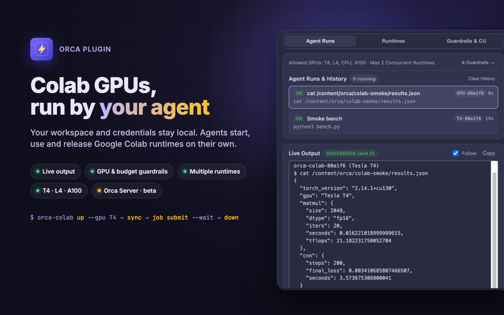

# orca-colab

[**English**](./README.md) | [**简体中文**](./README.zh-CN.md)



Use Google Colab GPUs as an autonomous compute backend for local coding agents in [Orca](https://github.com/stablyai/orca).
Your workspace, agent and credentials stay on your machine; Colab is a disposable GPU box the agent starts, uses and releases.

> **Unofficial community project.** Listed in Orca as *Orca Colab Community*. Not affiliated with or endorsed by Google; "Google Colab" is a trademark of Google LLC.

## What you get

- **Agents manage compute**: the agent checks your policy, provisions or scales parallel runtimes, syncs the
  workspace, installs dependencies, runs jobs and releases idle GPUs, all through one JSON CLI.
- **Live output**: every agent run streams into the **Colab GPU** panel in real time, with history, exit
  codes and per-run GPU attribution.
- **Humans set guardrails**: sign in with Google, pick the allowed GPU tiers (T4, L4, A100, CPU), cap
  concurrent runtimes and the monthly Compute Unit budget. The agent cannot step outside them.
- **Multiple runtimes and sessions**: run several GPUs side by side, name them, address them per command
  with `--session`, and switch between Google accounts.
- **Public endpoints only**: everything goes over HTTPS to Google's Colab API and the runtime's own
  proxy; no VPN, tailnet, SSH or open ports. `pull` downloads results (binary-safe) from the runtime.
- **Remote Orca servers (beta)**: the panel follows a project that lives on an Orca server and shows that
  server's runtimes, runs and credits through a Bridge Terminal. See [below](#remote-orca-servers-beta).

## Quick Start

### 1. Install

From the Orca Community Plugins marketplace (Settings → Plugins → `vzxxbacq.colab`), or from GitHub:

```sh
orca plugin install github:vzxxbacq/orca-colab
```

The plugin bundles the `colab-gpu` agent skill but never installs it on its own: open **Agent Skill** in the panel's setup view, tick the folders (`~/.agents/skills`, `~/.claude/skills`, `~/.gemini/config/skills`) and press Install; Remove takes it out again. To install only the skill without the plugin, or to develop the plugin locally:

```sh
npx skills add vzxxbacq/orca-colab
orca plugin dev load .
```

The CLI needs no install step; agents call it as `npx -y https://codeload.github.com/vzxxbacq/orca-colab/tar.gz/b36ab4a86ce21aba760485df41ea40d37757bb06 <command> --json`.

### 2. Configure

1. Open the **Colab GPU** panel in Orca and click **Sign in with Google**. On Google's consent page, tick **Read, write and delete your Colab resources** (or **Select all**); Google leaves it unticked by default.
2. Set allowed GPU tiers and concurrency limits under **Guardrails & CU**.
3. Ask your agent to run any GPU task.

## What an agent run looks like

A smoke test on a T4, exactly as the `colab-gpu` skill drives it:

```sh
orca-colab up --gpu T4 --json                                   # Tesla T4, ≈1.96 CU/h
orca-colab sync --json                                          # workspace → /content/orca/<dir>
orca-colab job submit --name "Smoke bench" --wait --json -- python3 bench.py
orca-colab run --json -- cat /content/orca/colab-smoke/results.json
orca-colab down --json                                          # runtime released
```

The whole round trip, including a 2048² fp16 matmul (≈21 TFLOPS) and 200 CNN training steps, took about
a minute of runtime and roughly 0.03 Compute Units. Credits in the panel and in `credits --json` are
estimates, labelled as such, and calibrated against your real balance on request.

## CLI

Full reference: [`skills/colab-gpu/references/cli.md`](./skills/colab-gpu/references/cli.md)

```sh
orca-colab auth [login --add | list | switch <account>] --json
orca-colab doctor --json
orca-colab up --gpu T4 [--new] [--name <name>] [--account <account>] --json
orca-colab job submit --name "Train" --wait --json -- <cmd>
orca-colab run --json -- <cmd>
orca-colab sync [path] --json
orca-colab pull <remote> <localDir> --json
orca-colab down [--all] --json
```

**Downloading results.** `orca-colab pull outputs ./results --json` packs `outputs` (relative to the synced
folder, or an absolute path such as `/content/model.pt`) into a tar.gz on the runtime, downloads it over
HTTPS from the runtime's own Jupyter server with the runtime's proxy token, and unpacks it into
`./results/outputs`. Files of any size and type arrive byte for byte; nothing needs to be reachable on
your network. There is no port forwarding: to query a service running on the runtime, use
`orca-colab run -- curl -s localhost:<port>/...`.

## Remote Orca servers (Beta)

If your project lives on a remote Orca server, the **Colab GPU** panel in the desktop app shows that
server's Colab state, not your laptop's: its runtimes, agent runs with live output, compute-unit
estimates and Google accounts. Local projects keep working exactly as before; the badge in the top bar
tells you which one you are looking at (`Local · <host>` or `Server · <host>`).

**How it works: a Bridge Terminal.** Orca gives plugins no way to run code on a remote server other than
its terminals, so the plugin keeps one terminal per server, titled `Colab Bridge · <server>`, running
`orca-colab watch`. That process streams the server's state back as compact frames and receives panel
actions as typed commands; the plugin opens it in the first project that needs it (through the local
`orca` CLI, over the connection you already have to the server) and every other project on that server
shares it. Leave it running; close it and the panel reopens it. Nothing else is installed, no port is
opened and no SSH or VPN is required.

Settings:

- **orca-colab command on remote Orca servers**: how to start `watch` on the server. Defaults to `npx` of
  this repository; for a checkout on the server use `node /path/to/orca-colab/bin/orca-colab.mjs`.
- **Open the bridge terminal on remote servers automatically**: turn off to start the terminal
  yourself; the panel then shows the exact command.

Google sign-in from the panel happens in your own browser; the tokens are sealed to the server's `watch`
process (X25519 + AES-256-GCM) before they cross the terminal, and nothing is stored on the laptop.
Changes such as guardrails, budget or Keep apply in the panel immediately and are confirmed by the server
within a couple of seconds; a failure shows up as a notice.

Known limits of the beta: the bridge terminal is visible (Orca has no hidden terminals); the panel follows
your focused project with about a second of delay; live output shows the last 120 lines of the selected
task; a project with the same name and branch on the laptop and on a server may be told apart only once
either has a terminal open; browser clients run no plugin worker, so this works from the desktop app only.

## License

MIT
