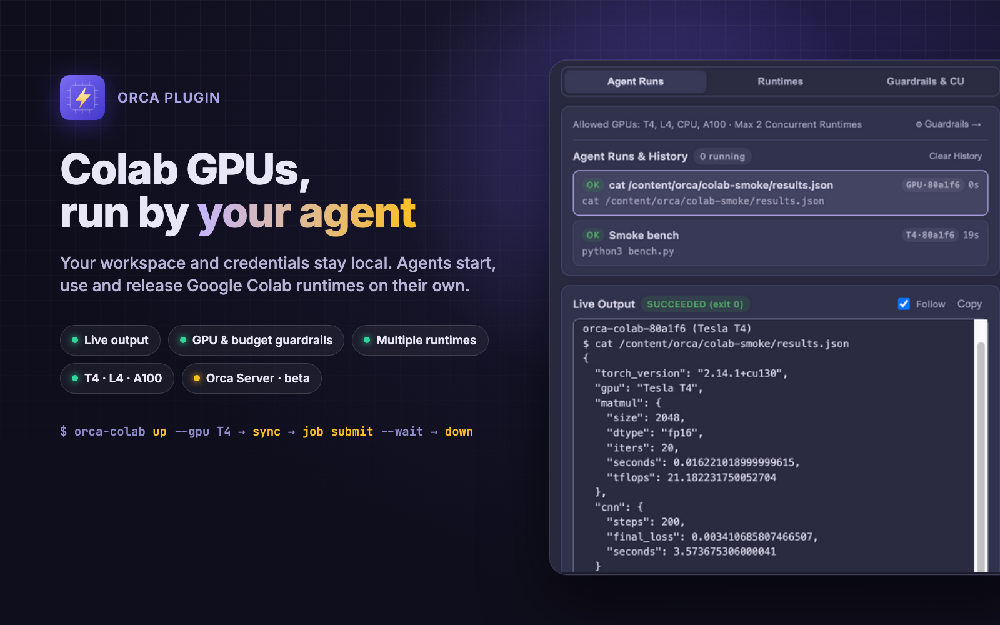

# Colab GPU for Orca: Google Colab GPUs for Claude Code, Codex and other AI coding agents

[**English**](./README.md) | [**简体中文**](./README.zh-CN.md) · [**Install from the Orca plugin directory**](https://orca.dev/plugins/vzxxbacq/orca-colab)



**Colab GPU for Orca** (`orca-colab`) is an Orca plugin and command-line tool that lets Claude Code, Codex and other
AI coding agents run jobs on Google Colab GPUs.

Your coding agent needs a GPU; your laptop doesn't have one. **Colab GPU for Orca** lets Claude Code, Codex
and any other agent in [Orca](https://github.com/stablyai/orca) start a Google Colab T4, L4 or A100 runtime
on its own, sync the workspace, run training, fine-tuning or inference jobs, pull checkpoints and metrics
back, and shut the runtime down when it's done, with live output and compute-unit tracking in an Orca panel.
Your code, agents and credentials stay on your machine, and it runs on your own Colab account and
compute units. No VPN, SSH or notebook to babysit.

Install it in Orca from the [plugin directory](https://orca.dev/plugins/vzxxbacq/orca-colab) (**Colab GPU (Community) for Orca**), or use the
CLI alone with `npx`. A community project, not affiliated with Google.

## What you get

- **Agents manage compute**: the agent checks your policy, provisions or scales parallel runtimes, syncs the
  workspace, installs dependencies, runs jobs and releases idle GPUs, all through one JSON CLI.
- **Live output**: every agent run streams into the **Colab GPU** panel in real time, with history, exit
  codes and per-run GPU attribution.
- **Humans set guardrails**: sign in with Google, pick the allowed GPU tiers (T4, L4, A100, CPU), cap
  concurrent runtimes and the monthly Compute Unit budget. The agent cannot step outside them.
- **Multiple runtimes and sessions**: run several GPUs side by side, name them, address them per command
  with `--session`, and switch between Google accounts.
- **Public endpoints only**: everything goes over HTTPS to Google's Colab API and the runtime's own
  proxy; no VPN, tailnet, SSH or open ports. `pull` downloads results (binary-safe) from the runtime.
- **Remote Orca servers (beta)**: the panel follows a project that lives on an Orca server and shows that
  server's runtimes, runs and credits through a Bridge Terminal. See [below](#remote-orca-servers-beta).

## Quick Start

### 1. Install

From the Orca Community Plugins marketplace (Settings → Plugins → `vzxxbacq.colab`), or from GitHub:

```sh
orca plugin install github:vzxxbacq/orca-colab
```

The plugin bundles the `colab-gpu` agent skill but never installs it on its own: open **Agent Skill** in the panel's setup view, tick the folders (`~/.agents/skills`, `~/.claude/skills`, `~/.gemini/config/skills`) and press Install; Remove takes it out again. To install only the skill without the plugin, or to develop the plugin locally:

```sh
npx skills add vzxxbacq/orca-colab
orca plugin dev load .
```

The CLI needs no install step; agents call it as `npx -y https://codeload.github.com/vzxxbacq/orca-colab/tar.gz/2944ee151e7ef2d08a5598c00c6cce4e3109f13c <command> --json`.

### 2. Configure

1. Open the **Colab GPU** panel in Orca and click **Sign in with Google**. On Google's consent page, tick **Read, write and delete your Colab resources** (or **Select all**); Google leaves it unticked by default.
2. Set allowed GPU tiers and concurrency limits under **Guardrails & CU**.
3. Ask your agent to run any GPU task.

### Google sign-in relay

Signing in uses the plugin's own Google OAuth client (Google's consent screen shows it as
*Colab GPU (Community) for Orca*). Google requires that client's secret on
every token request, so instead of shipping it inside the CLI, a small Cloudflare Worker,
`https://orca-colab-token-relay.fhq981014.workers.dev`, holds it. **The Worker does exactly one thing:**
it takes the one-time authorization code your own machine received (or a refresh token), adds the client
secret, sends that single request to `oauth2.googleapis.com/token` and returns Google's answer unchanged.
It stores nothing, logs nothing (request logs are off), never calls any Colab API and cannot act on your
account by itself. To keep one client from using up its free quota, it counts requests per IP address in
memory (30 a minute, 300 an hour). Its whole source is [`token-relay/src/index.mjs`](./token-relay/src/index.mjs).

To bypass it, create your own Desktop OAuth client in Google Cloud and set `ORCA_COLAB_CLIENT_ID` and
`ORCA_COLAB_CLIENT_SECRET`; orca-colab then talks to Google directly. `orca-colab auth logout` revokes
your token at Google before deleting it from `~/.orca-colab`.

## What an agent run looks like

A smoke test on a T4, exactly as the `colab-gpu` skill drives it:

```sh
orca-colab up --gpu T4 --json                                   # Tesla T4, ≈1.96 CU/h
orca-colab sync --json                                          # workspace → /content/orca/<dir>
orca-colab job submit --name "Smoke bench" --wait --json -- python3 bench.py
orca-colab run --json -- cat /content/orca/colab-smoke/results.json
orca-colab down --json                                          # runtime released
```

The whole round trip, including a 2048² fp16 matmul (≈21 TFLOPS) and 200 CNN training steps, took about
a minute of runtime and roughly 0.03 Compute Units. Credits in the panel and in `credits --json` are
estimates, labelled as such, and calibrated against your real balance on request.

## FAQ

### What is Colab GPU for Orca?
An Orca plugin and CLI (`orca-colab`) that gives AI coding agents a GPU. The agent starts a Google Colab
runtime on your account, syncs the workspace to it, runs jobs there and pulls the results back. It is listed
in the Orca plugin directory as *Colab GPU (Community) for Orca*.

### How do I give Claude Code (or Codex) a GPU?
Install the plugin in Orca, click **Sign in with Google** in the Colab GPU panel, then ask the agent for GPU
work. Through the bundled `colab-gpu` skill it runs `orca-colab up --gpu T4`, `sync`, `job submit --wait`,
`pull` and `down` on its own, and you watch the live output in the panel.

### Can I use it without Orca?
Yes. The CLI runs anywhere with Node.js 20+: `npx -y https://codeload.github.com/vzxxbacq/orca-colab/tar.gz/<release> <command> --json`
(the exact pinned command is in each [release](https://github.com/vzxxbacq/orca-colab/releases)). Any agent
can use it through the skill: `npx skills add vzxxbacq/orca-colab`, or as an MCP server: see
[Use as a connector (MCP)](#use-as-a-connector-mcp).

### Which GPUs can it use?
Whatever Colab offers your account: typically T4, L4 and A100, plus CPU runtimes. You choose which ones
agents may start and how many at once under **Guardrails & CU**.

### How much does it cost?
The plugin is free and open source (MIT). Runtimes use your own Colab compute units at Colab's rates (a T4
reported about 1.2 CU/hour in our tests). The panel tracks your balance and a monthly budget, and, while Orca
is running, stops a forgotten idle runtime after 20 minutes (configurable). A full smoke test on a T4 took
about a minute and roughly 0.03 CU.

### Do I need SSH, ngrok, Tailscale or a VPN?
No. Everything goes over HTTPS and WebSockets to the Colab API and the runtime's own proxy. Nothing has to be
reachable on your network and no port is opened. The flip side: there is no port forwarding; to query a
server running on the runtime, use `orca-colab run -- curl -s localhost:<port>/...`.

### Does my code leave my machine?
Only what you sync, and only to your own Colab runtime. Agents, the workspace and your Google tokens stay on
your computer. Sign-in token requests pass through a [small relay](#google-sign-in-relay) that adds the app's
client secret and stores nothing.

### How do I get results back?
`orca-colab pull <remote path> <local dir> --json` packs the file or folder on the runtime, downloads it over
HTTPS and unpacks it locally. Binary files (checkpoints, weights) arrive byte for byte.

### What happens when the Colab runtime disconnects?
Colab runtimes are disposable and time-limited. Pull results as soon as they exist; if a runtime is gone,
`status --json` shows it and the agent can `down`, `up` and `sync` again.

### How is it different from the Colab extension for VS Code?
Google's extension connects notebooks open in VS Code to a Colab runtime for a person to work in. This
project is built for agents: a JSON CLI, a job manager with live logs, file sync and pull, budget guardrails
and an Orca panel. It is a community project, not affiliated with Google.

### How is it different from Modal, RunPod or other GPU clouds?
Those are separate GPU clouds with their own accounts and billing, better suited to long-running or
production workloads. Colab GPU for Orca reuses the Colab subscription or compute units you already have and
fits interactive experiments, fine-tuning and evaluation runs within Colab's session limits.

## CLI

Full reference: [`skills/colab-gpu/references/cli.md`](./skills/colab-gpu/references/cli.md)

```sh
orca-colab auth [login --add | list | switch <account>] --json
orca-colab doctor --json
orca-colab up --gpu T4 [--new] [--name <name>] [--account <account>] --json
orca-colab job submit --name "Train" --wait --json -- <cmd>
orca-colab run --json -- <cmd>
orca-colab sync [path] --json
orca-colab pull <remote> <localDir> --json
orca-colab down [--all] --json
```

**Downloading results.** `orca-colab pull outputs ./results --json` packs `outputs` (relative to the synced
folder, or an absolute path such as `/content/model.pt`) into a tar.gz on the runtime, downloads it over
HTTPS from the runtime's own Jupyter server with the runtime's proxy token, and unpacks it into
`./results/outputs`. Files of any size and type arrive byte for byte; nothing needs to be reachable on
your network. There is no port forwarding: to query a service running on the runtime, use
`orca-colab run -- curl -s localhost:<port>/...`.

## Use as a connector (MCP)

`orca-colab mcp` serves the whole CLI as [MCP](https://modelcontextprotocol.io) tools on stdio, so an agent
needs neither the skill nor a shell. Add it to an Orca bot:

```sh
orca bot tools add "npx -y https://codeload.github.com/vzxxbacq/orca-colab/tar.gz/2944ee151e7ef2d08a5598c00c6cce4e3109f13c mcp" --name colab
```

Claude Code and Codex (Orca bots also pick up the tools of your own Claude Code or Codex setup):

```sh
claude mcp add colab --scope user -- npx -y https://codeload.github.com/vzxxbacq/orca-colab/tar.gz/2944ee151e7ef2d08a5598c00c6cce4e3109f13c mcp
codex mcp add colab -- npx -y https://codeload.github.com/vzxxbacq/orca-colab/tar.gz/2944ee151e7ef2d08a5598c00c6cce4e3109f13c mcp
```

Any other MCP client: command `npx`, arguments `-y https://codeload.github.com/vzxxbacq/orca-colab/tar.gz/2944ee151e7ef2d08a5598c00c6cce4e3109f13c mcp`.

- **Tools**: `doctor`, `status`, `up`, `sync`, `run`, `job_submit`, `job_list`, `job_logs`, `job_wait`,
  `job_stop`, `pull`, `down`, `credits`, `credits_calibrate`, `credits_set`, `credits_budget`, `ledger`,
  `rates`, and `auth_status`, `auth_login`, `auth_wait`, `auth_redirect`, `auth_list`, `auth_switch`,
  `auth_logout`. Each one runs the CLI command of the same name and returns its JSON, so your guardrails
  (allowed GPUs, runtime cap, budget) apply unchanged.
- **Sign-in from the agent**: with no Google sign-in, the agent calls `auth_login`. Your browser opens
  Google's consent page (the agent also gets the link to show you); tick **Read, write and delete your Colab
  resources** and the agent's `auth_wait` sees the sign-in finish. No terminal, no panel.
- **Same state as the panel**: the server reads and writes the same `~/.orca-colab` as the CLI. Runtimes,
  runs, jobs with live output, credits and the sign-in appear in the **Colab GPU** panel as they happen, and
  what you change there (guardrails, account, stopping a runtime or a job) is what the agent's next call sees.
- **Paths**: the server does not run in your workspace, so `sync`, `pull` and `job_submit` with `sync` take
  `workspace_path` (clients that expose a single MCP root need not pass it).
- **Long work**: `job_submit` returns a job id at once; `job_wait` and `job_logs` follow it. Waits default to
  45 seconds. Codex stops a tool call after 60 seconds, which a slow `up` can exceed: the runtime is still
  created (`status` shows it), or set `tool_timeout_sec = 300` under `[mcp_servers.colab]` in
  `~/.codex/config.toml`.

## Remote Orca servers (Beta)

If your project lives on a remote Orca server, the **Colab GPU** panel in the desktop app shows that
server's Colab state, not your laptop's: its runtimes, agent runs with live output, compute-unit
estimates and Google accounts. Local projects keep working exactly as before; the badge in the top bar
tells you which one you are looking at (`Local · <host>` or `Server · <host>`).

**How it works: a Bridge Terminal.** Orca gives plugins no way to run code on a remote server other than
its terminals, so the plugin keeps one terminal per server, titled `Colab Bridge · <server>`, running
`orca-colab watch`. That process streams the server's state back as compact frames and receives panel
actions as typed commands; the plugin opens it in the first project that needs it (through the local
`orca` CLI, over the connection you already have to the server) and every other project on that server
shares it. Leave it running; close it and the panel reopens it. Nothing else is installed, no port is
opened and no SSH or VPN is required.

Settings:

- **orca-colab command on remote Orca servers**: how to start `watch` on the server. Defaults to `npx` of
  this repository; for a checkout on the server use `node /path/to/orca-colab/bin/orca-colab.mjs`.
- **Open the bridge terminal on remote servers automatically**: turn off to start the terminal
  yourself; the panel then shows the exact command.

Google sign-in from the panel happens in your own browser; the tokens are sealed to the server's `watch`
process (X25519 + AES-256-GCM) before they cross the terminal, and nothing is stored on the laptop.
Changes such as guardrails, budget or Keep apply in the panel immediately and are confirmed by the server
within a couple of seconds; a failure shows up as a notice.

Known limits of the beta: the bridge terminal is visible (Orca has no hidden terminals); the panel follows
your focused project with about a second of delay; live output shows the last 120 lines of the selected
task; a project with the same name and branch on the laptop and on a server may be told apart only once
either has a terminal open; browser clients run no plugin worker, so this works from the desktop app only.

## License

MIT
