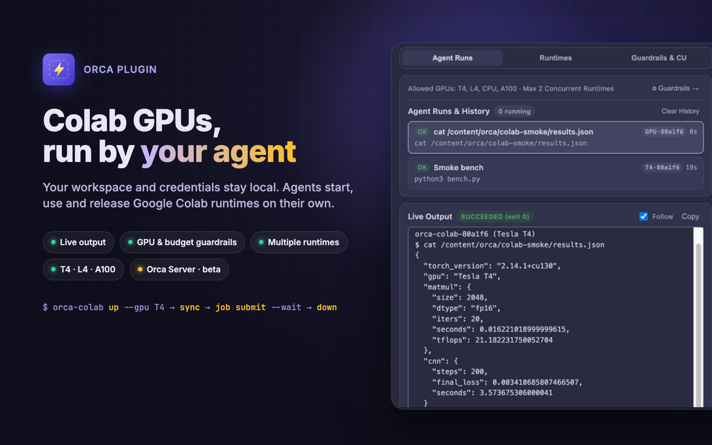

# Colab GPU for Orca：让 Claude Code、Codex 等 AI 编程 Agent 用上 Google Colab GPU

[**English**](./README.md) | [**简体中文**](./README.zh-CN.md) · [**从 Orca 插件目录安装**](https://orca.dev/plugins/vzxxbacq/orca-colab)



Agent 需要 GPU，笔记本却没有。**Colab GPU for Orca** 让 [Orca](https://github.com/stablyai/orca) 里的
Claude Code、Codex 等 Agent 自己开一台 Google Colab T4、L4 或 A100，同步工作区，跑训练、微调或推理，把权重和
指标拉回本地，用完自动释放；Orca 面板里能看到实时输出和算力消耗。代码、Agent 和凭据都留在本机，用的是你自己的
Colab 账号和计算单元，不需要 VPN、SSH，也不用守着 notebook。

在 Orca 的[插件目录](https://orca.dev/plugins/vzxxbacq/orca-colab)里搜索 **Colab GPU (Community) for Orca** 即可安装，也可以单独用 `npx` 运行 CLI。
社区项目，与 Google 无关联。

## 你将获得

- **Agent 自治算力**：Agent 自动检查策略、按需开启或并发扩容运行时、同步工作区、安装依赖、提交任务并在空闲时释放 GPU，
  全部通过同一个 JSON CLI 完成。
- **Live Output 实时输出**：每个 Agent 任务的输出实时流入 **Colab GPU** 面板，带历史记录、退出码和所用 GPU 标注。
- **人只设边界**：一键登录 Google，选择允许的 GPU 级别（T4、L4、A100、CPU），限制并发运行时数量和月度计算单元预算，
  Agent 无法越界。
- **多运行时、多 Session**：多块 GPU 并行，可命名、可用 `--session` 逐条指定，并支持多个 Google 账号切换。
- **只用公网接口**：全部通过 HTTPS 访问 Google 的 Colab API 和运行时自带的代理，不需要 VPN、tailnet、SSH 或开放端口；`pull` 可把结果（含二进制文件）下载回本机。
- **远程 Orca 服务器（Beta）**：项目位于 Orca 服务器上时，面板通过 Bridge Terminal 跟随显示该服务器的运行时、任务和算力。
  详见[下文](#远程-orca-服务器beta)。

## 快速开始

### 1. 安装

在 Orca Community Plugins 市场中安装（Settings → Plugins → `vzxxbacq.colab`），或直接从 GitHub 安装：

```sh
orca plugin install github:vzxxbacq/orca-colab
```

插件自带 `colab-gpu` Agent Skill，但不会自动安装：在面板设置页展开 **Agent Skill**，勾选目录（`~/.agents/skills`、`~/.claude/skills`、`~/.gemini/config/skills`）后点 Install；Remove 可再移除。不装插件只装 Skill，或本地开发插件：

```sh
npx skills add vzxxbacq/orca-colab
orca plugin dev load .
```

CLI 无需单独安装，Agent 通过 `npx -y https://codeload.github.com/vzxxbacq/orca-colab/tar.gz/2a0ce6cab8a0995f5ba417cf3de4d59c8e3703fd <command> --json` 直接调用。

### 2. 配置

1. 在 Orca 右侧打开 **Colab GPU** 面板，点击 **Sign in with Google**。在 Google 授权页上勾选 **Read, write and delete your Colab resources**（或"全选"），Google 默认不勾选这一项。
2. 在 **Guardrails & CU** 中设置允许的 GPU 级别与并发上限。
3. 直接让 Agent 执行 GPU 任务即可。

### Google 登录中转

登录使用 Colab GPU (Community) for Orca 自己的 Google OAuth client。Google 要求每次换取 token 都带上这个 client 的
secret，为了不把它打包进 CLI，我们把它放在一个很小的 Cloudflare Worker 里：
`https://orca-colab-token-relay.fhq981014.workers.dev`。**这个 Worker 只做一件事**：接收你本机拿到的一次性
授权码（或 refresh token），补上 client secret，把这一个请求发给 `oauth2.googleapis.com/token`，再把
Google 的回复原样返回。它不保存、不记录（请求日志已关闭）任何内容，从不调用 Colab 的任何接口，自己也无法操作
你的账号。为防止单个客户端耗尽免费额度，它会在内存中按 IP 地址计数（每分钟 30 次、每小时 300 次）。完整源码见 [`token-relay/src/index.mjs`](./token-relay/src/index.mjs)。

如果不想经过它，可以在 Google Cloud 创建自己的桌面应用 OAuth client，设置 `ORCA_COLAB_CLIENT_ID` 和
`ORCA_COLAB_CLIENT_SECRET`，orca-colab 就会直接连接 Google。`orca-colab auth logout` 会先在 Google 侧撤销
token，再从 `~/.orca-colab` 删除。

## 一次 Agent 任务长什么样

在 T4 上跑一次冒烟测试，就是 `colab-gpu` Skill 的标准流程：

```sh
orca-colab up --gpu T4 --json                                   # Tesla T4，约 1.96 CU/h
orca-colab sync --json                                          # 工作区 → /content/orca/<目录>
orca-colab job submit --name "Smoke bench" --wait --json -- python3 bench.py
orca-colab run --json -- cat /content/orca/colab-smoke/results.json
orca-colab down --json                                          # 释放运行时
```

整个流程（含 2048² fp16 矩阵乘法约 21 TFLOPS、200 步 CNN 训练）只占用约一分钟运行时，消耗约 0.03 个计算单元。
面板和 `credits --json` 中的算力数字都是估算值并明确标注，可随时按真实余额校准。

## CLI

完整命令参考：[`skills/colab-gpu/references/cli.md`](./skills/colab-gpu/references/cli.md)

```sh
orca-colab auth [login --add | list | switch <account>] --json
orca-colab doctor --json
orca-colab up --gpu T4 [--new] [--name <name>] [--account <account>] --json
orca-colab job submit --name "Train" --wait --json -- <cmd>
orca-colab run --json -- <cmd>
orca-colab sync [path] --json
orca-colab pull <remote> <localDir> --json
orca-colab down [--all] --json
```

**下载结果。** `orca-colab pull outputs ./results --json` 会在运行时上把 `outputs`（相对于同步目录，也可以是
`/content/model.pt` 这样的绝对路径）打成 tar.gz，用运行时的代理 token 通过 HTTPS 从运行时自带的 Jupyter
服务下载，再解压到 `./results/outputs`。任何大小和类型的文件都按字节原样到达，不需要任何内网可达。
不支持端口转发：要访问运行时上的服务，用 `orca-colab run -- curl -s localhost:<端口>/...`。

## 远程 Orca 服务器（Beta）

如果项目位于远程 Orca 服务器上，桌面端的 **Colab GPU** 面板显示的是该服务器上的 Colab 状态，而不是本机的：
它的运行时、Agent 任务和实时输出、算力估算和 Google 账号。本地项目的行为保持不变；顶栏的标识会告诉你当前看的是哪一边
（`Local · <主机>` 或 `Server · <主机>`）。

**实现方式：Bridge Terminal。** Orca 没有给插件在远程服务器上执行代码的接口，终端是唯一通道，所以插件为每台服务器
维护一个名为 `Colab Bridge · <服务器>` 的终端，里面运行 `orca-colab watch`。这个进程把服务器状态编码成紧凑的帧流回传，
并接收面板动作作为输入命令；插件通过本机 `orca` CLI、复用你已有的服务器连接，在第一个需要它的项目里打开该终端，
同一服务器上的其他项目共用它。请让它一直运行；关掉后面板会重新打开。不安装任何额外东西，不开端口，不需要 SSH 或 VPN。

设置项：

- **orca-colab command on remote Orca servers**：在服务器上启动 `watch` 的命令。默认用 `npx` 拉取本仓库；
  服务器上有源码时填 `node /path/to/orca-colab/bin/orca-colab.mjs`。
- **Open the bridge terminal on remote servers automatically**：关闭后由你自己启动终端，面板会给出准确的命令。

面板上的 Google 登录在你本机浏览器完成；token 先用服务器端 `watch` 进程的密钥加密（X25519 + AES-256-GCM）再经终端传输，
本机不保存任何凭据。护栏、预算、Keep 等修改在面板上即时生效，服务器在一两秒内确认，失败会弹出提示。

Beta 阶段的已知限制：桥接终端是可见的（Orca 没有隐藏终端）；面板跟随聚焦项目约有 1 秒延迟；实时输出只显示所选任务的
最后 120 行；本机和服务器上同名同分支的项目，只有在其中一方开了终端时才能可靠区分；浏览器客户端不运行插件 worker，
该功能仅限桌面应用。

## 开源协议

MIT
