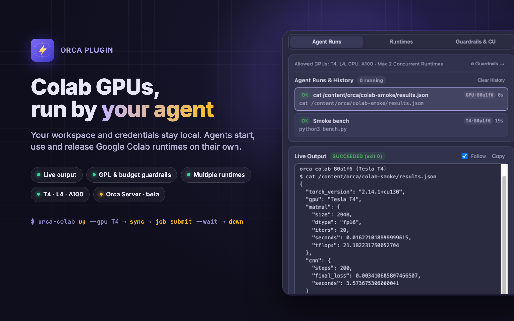

# Colab GPU for Orca：让 Claude Code、Codex 等 AI 编程 Agent 用上 Google Colab GPU

[**English**](./README.md) | [**简体中文**](./README.zh-CN.md) · [**从 Orca 插件目录安装**](https://orca.dev/plugins/vzxxbacq/orca-colab)



**Colab GPU for Orca**（`orca-colab`）是一个 Orca 插件和命令行工具，让 Claude Code、Codex 等 AI 编程 Agent 在 Google Colab GPU 上运行任务。

Agent 需要 GPU，笔记本却没有。**Colab GPU for Orca** 让 [Orca](https://github.com/stablyai/orca) 里的
Claude Code、Codex 等 Agent 自己开一台 Google Colab T4、L4 或 A100，同步工作区，跑训练、微调或推理，把权重和
指标拉回本地，用完自动释放；Orca 面板里能看到实时输出和算力消耗。代码、Agent 和凭据都留在本机，用的是你自己的
Colab 账号和计算单元，不需要 VPN、SSH，也不用守着 notebook。

在 Orca 的[插件目录](https://orca.dev/plugins/vzxxbacq/orca-colab)里搜索 **Colab GPU (Community) for Orca** 即可安装，也可以单独用 `npx` 运行 CLI。
社区项目，与 Google 无关联。

## 你将获得

- **Agent 自治算力**：Agent 自动检查策略、按需开启或并发扩容运行时、同步工作区、安装依赖、提交任务并在空闲时释放 GPU，
  全部通过同一个 JSON CLI 完成。
- **Live Output 实时输出**：每个 Agent 任务的输出实时流入 **Colab GPU** 面板，带历史记录、退出码和所用 GPU 标注。
- **人只设边界**：一键登录 Google，选择允许的 GPU 级别（T4、L4、A100、CPU），限制并发运行时数量和月度计算单元预算，
  Agent 无法越界：本月估算用量达到预算后，`up` 会拒绝启动新的运行时（已在运行的不受影响），直到你在面板里或用
  `orca-colab credits budget <cu>` 调高预算。
- **多运行时、多 Session**：多块 GPU 并行，可命名、可用 `--session` 逐条指定，并支持多个 Google 账号切换。
- **只用公网接口**：全部通过 HTTPS 访问 Google 的 Colab API 和运行时自带的代理，不需要 VPN、tailnet、SSH 或开放端口；`pull` 可把结果（含二进制文件）下载回本机。
- **每台机器看到同一批运行时**：面板和 CLI 列出当前登录的 Google 账号下的全部运行时，包括 Agent 在另一台电脑或远程 Orca
  服务器上启动的，连同任务和实时输出。不需要 bridge，也不打开任何终端。详见[下文](#多台机器一个账号)。

## 快速开始

### 1. 安装

在 Orca Community Plugins 市场中安装（Settings → Plugins → `vzxxbacq.colab`），或直接从 GitHub 安装：

```sh
orca plugin install github:vzxxbacq/orca-colab
```

插件自带 `colab-gpu` Agent Skill，但不会自动安装：在面板设置页展开 **Agent Skill**，勾选目录（`~/.agents/skills`、`~/.claude/skills`、`~/.gemini/config/skills`）后点 Install；Remove 可再移除。不装插件只装 Skill，或本地开发插件：

```sh
npx skills add vzxxbacq/orca-colab
orca plugin dev load .
```

CLI 无需单独安装，Agent 通过 `npx -y https://codeload.github.com/vzxxbacq/orca-colab/tar.gz/621b5c5e58328fa5e3aa67482f8985290c8f4c3b <command> --json` 直接调用。

### 2. 配置

1. 在 Orca 右侧打开 **Colab GPU** 面板，点击 **Sign in with Google**。在 Google 授权页上勾选 **Read, write and delete your Colab resources**（或"全选"），Google 默认不勾选这一项。
2. 在 **Guardrails & CU** 中设置允许的 GPU 级别与并发上限。
3. 直接让 Agent 执行 GPU 任务即可。

### Google 登录中转

登录使用 Colab GPU (Community) for Orca 自己的 Google OAuth client。Google 要求每次换取 token 都带上这个 client 的
secret，为了不把它打包进 CLI，我们把它放在一个很小的 Cloudflare Worker 里：
`https://orca-colab-token-relay.fhq981014.workers.dev`。**这个 Worker 只做一件事**：接收你本机拿到的一次性
授权码（或 refresh token），补上 client secret，把这一个请求发给 `oauth2.googleapis.com/token`，再把
Google 的回复原样返回。它不保存、不记录（请求日志已关闭）任何内容，从不调用 Colab 的任何接口，自己也无法操作
你的账号。为防止单个客户端耗尽免费额度，它会在内存中按 IP 地址计数（每分钟 30 次、每小时 300 次）。完整源码见 [`token-relay/src/index.mjs`](./token-relay/src/index.mjs)。

如果不想经过它，可以在 Google Cloud 创建自己的桌面应用 OAuth client，设置 `ORCA_COLAB_CLIENT_ID` 和
`ORCA_COLAB_CLIENT_SECRET`，orca-colab 就会直接连接 Google。`orca-colab auth logout` 会先在 Google 侧撤销
token，再从 `~/.orca-colab` 删除。

### 使用代理上网

如果这台电脑只能通过 HTTP 或 SOCKS 代理访问 Google，orca-colab 的所有请求都会走代理：登录（中转和 Google）、
Colab API，以及运行时的 HTTPS 和 WebSocket。Node 默认不理会任何代理设置，所以 orca-colab 自己按以下顺序查找：

1. 任意命令上的 `--proxy <auto|off|url>`，或环境变量 `ORCA_COLAB_PROXY`。
2. 面板里的 **Setup → Network proxy**（Auto / Off / Proxy URL），保存在 `~/.orca-colab/config.json`，
   这台电脑上的 CLI 和 MCP 服务也会跟着用。
3. `HTTPS_PROXY`、`HTTP_PROXY`、`ALL_PROXY` 和 `NO_PROXY`（大小写均可）。
4. macOS（`scutil --proxy`）或 Windows（Internet 设置）的系统代理，因为 Orca 应用启动插件时不带 shell 里的
   环境变量。Linux 上请设置环境变量或面板里的选项。

支持 `http://`、`https://` 和 `socks5://` 代理，需要认证时把 `user:password@` 写进 URL。不支持自动配置（PAC）
脚本，请直接填代理地址。会解密 TLS 的代理需要把它的 CA 证书放进 `NODE_EXTRA_CA_CERTS`。本机地址（`127.0.0.1`、
`localhost`）始终直连。

`orca-colab doctor --network`（或面板里的 **Test connection**）会访问每一个端点，并逐个显示是否连通、耗时，以及
走的是哪个代理。请求发不出去时，报错是 `Could not reach <host>: <原因代码> …`，并写明正在使用的代理，不再是
`fetch failed`。

## 一次 Agent 任务长什么样

在 T4 上跑一次冒烟测试，就是 `colab-gpu` Skill 的标准流程：

```sh
orca-colab up --gpu T4 --json                                   # Tesla T4，约 1.96 CU/h
orca-colab sync --json                                          # 工作区 → /content/orca/<目录>
orca-colab job submit --name "Smoke bench" --wait --json -- python3 bench.py
orca-colab run --json -- cat /content/orca/colab-smoke/results.json
orca-colab down --json                                          # 释放运行时
```

整个流程（含 2048² fp16 矩阵乘法约 21 TFLOPS、200 步 CNN 训练）只占用约一分钟运行时，消耗约 0.03 个计算单元。
面板和 `credits --json` 中的算力数字都是估算值并明确标注，可随时按真实余额校准。

## 常见问题

### Colab GPU for Orca 是什么？
一个 Orca 插件和命令行工具（`orca-colab`），让 AI 编程 Agent 用上 GPU：Agent 在你的账号下开一台 Google Colab
运行时，把工作区同步过去，在上面跑任务，再把结果拉回本地。在 Orca 插件目录中的名字是 *Colab GPU (Community) for Orca*。

### 怎样让 Claude Code（或 Codex）用上 GPU？
在 Orca 里安装插件，在 Colab GPU 面板点 **Sign in with Google**，然后直接让 Agent 做 GPU 任务。它会通过自带的
`colab-gpu` skill 自己运行 `orca-colab up --gpu T4`、`sync`、`job submit --wait`、`pull` 和 `down`，你在面板里看实时输出。

### 不用 Orca 可以吗？
可以。CLI 在任何装了 Node.js 20+ 的机器上都能运行：`npx -y https://codeload.github.com/vzxxbacq/orca-colab/tar.gz/<release> <command> --json`
（每个 [release](https://github.com/vzxxbacq/orca-colab/releases) 里都有固定版本的完整命令）。任何 Agent 都可以通过
skill 使用它：`npx skills add vzxxbacq/orca-colab`，或把它当作 MCP 服务：见[作为连接器使用（MCP）](#作为连接器使用mcp)。

### 能用哪些 GPU？
你的 Colab 账号能用的都可以，通常是 T4、L4、A100，以及 CPU 运行时。在 **Guardrails & CU** 里可以限定 Agent 能开哪些 GPU、最多同时开几台。

### 要花多少钱？
插件本身免费、开源（MIT）。运行时消耗的是你自己的 Colab 计算单元，按 Colab 的费率计（我们实测 T4 约每小时 1.2 CU）。
面板会跟踪余额和月度预算；Orca 运行时，闲置的运行时会在 20 分钟后被自动停掉（可配置）。在 T4 上跑一次完整的冒烟测试约 1 分钟、约 0.03 CU。

### 需要 SSH、ngrok、Tailscale 或 VPN 吗？
不需要。所有通信都是通过 HTTPS 和 WebSocket 访问 Colab API 和运行时自带的代理，不需要内网可达，也不开放任何端口。
运行时上也不会开放端口。要访问运行在上面的 HTTP 服务，用 [`orca-colab forward`](#端口转发)：它在本机监听，
每个请求都走同一条已认证的通道。

### 我的代码会离开本机吗？
只有你同步的内容，而且只会到你自己的 Colab 运行时。Agent、工作区和 Google token 都留在本机。登录换 token 的请求会经过一个
[小型中转](#google-登录中转)，它只补上应用的 client secret，不保存任何内容。

### 怎么把结果拿回来？
`orca-colab pull <远程路径> <本地目录> --json` 会在运行时上打包文件或目录，通过 HTTPS 下载后在本地解压。
二进制文件（checkpoint、权重）按字节原样到达。

### Colab 运行时断开了怎么办？
Colab 运行时是一次性的，并且有时长限制。结果一产生就及时拉回；运行时没了，`status --json` 会显示出来，Agent 可以重新
`down`、`up`、`sync`。

### 为什么 Colab 在 20 到 40 分钟后收回了我的运行时？
Colab 会收回它认为无人值守的运行时，不管上面在跑什么，也不给出原因。Colab 自己的客户端把“某个 notebook kernel 上有
客户端连接”视为运行时在使用中。从 v0.4.3 起，只要运行时在使用，orca-colab 就保持这样一个连接：每个运行超过十秒的命令
（被跟随的任务、`forward`、较长的 `run`），以及 Orca 面板和 MCP 服务器（针对有任务在运行的会话、最后一次命令后的 20 分钟内、
以及始终针对保留的会话 `up --keep`）。这个 kernel 上不会执行任何代码；会话空闲后连接就断开，所以空闲自动停止和 Colab
自己的限制仍然会释放不用的运行时。**必须有一台机器保持开机并联网**：任务不再能在所有客户端都消失后继续存活。`status` 为每个
会话显示 `client-connected=yes|no`（`--json` 中为 `presence`），被 Colab 结束的会话会显示为 *ended by Colab after about N min*，
并说明结束前是否有客户端连接。

### 登录最后显示 "Google Colab sign-in failed" 或 "fetch failed" 怎么办？
浏览器能访问 Google，但 orca-colab 自己访问不了：登录的最后一步是由这台电脑向登录中转和 Google 发请求，浏览器会走
系统代理，Node 不会。从 v0.4.2 起，失败页面和面板会写明是哪个主机、什么原因（`ENOTFOUND`、`ECONNREFUSED`、
`ETIMEDOUT`、证书错误）以及正在使用的代理。打开面板的 **Setup → Network proxy**，点 **Test connection**，
没有找到代理就填上，然后再点一次 **Sign in**，不需要重启。详见[使用代理上网](#使用代理上网)。

### 和 Colab 的 VS Code 扩展有什么区别？
Google 的扩展是把 VS Code 里打开的 notebook 连接到 Colab 运行时，供人使用。本项目是为 Agent 做的：JSON 输出的 CLI、
带实时日志的任务管理、文件同步和拉回、预算限制，以及 Orca 面板。本项目是社区项目，与 Google 无关联。

### 和 Modal、RunPod 等 GPU 云有什么区别？
它们是独立的 GPU 云，需要单独的账号和付费，更适合长时间运行或生产负载。Colab GPU for Orca 复用你已有的 Colab 订阅或计算单元，
适合在 Colab 会话时长内做交互式实验、微调和评测。

## CLI

完整命令参考：[`skills/colab-gpu/references/cli.md`](./skills/colab-gpu/references/cli.md)

```sh
orca-colab auth [login --add | list | switch <account>] --json
orca-colab doctor [--network] --json
orca-colab up --gpu T4 [--new] [--name <name>] [--account <account>] --json
orca-colab job submit --name "Train" --wait --json -- <cmd>
orca-colab run --json -- <cmd>
orca-colab sync [path] --json
orca-colab pull <remote> <localDir> --json
orca-colab forward --port <远端端口> [--listen 127.0.0.1:<本地端口>]
orca-colab down [--all] --json
orca-colab --proxy <auto|off|url> <command>   # 或 ORCA_COLAB_PROXY，见"使用代理上网"
```

**下载结果。** `orca-colab pull outputs ./results --json` 会在运行时上把 `outputs`（相对于同步目录，也可以是
`/content/model.pt` 这样的绝对路径）打成 tar.gz，用运行时的代理 token 通过 HTTPS 从运行时自带的 Jupyter
服务下载，再解压到 `./results/outputs`。任何大小和类型的文件都按字节原样到达，不需要任何内网可达。

### 端口转发

```sh
orca-colab forward --port 8000 [--session <name>] [--listen 127.0.0.1:8000] [--timeout 300]
```

命令运行期间，本机的 `http://127.0.0.1:8000` 返回的就是运行时上 8000 端口的响应：方法、路径、查询串、请求头、请求体、
状态码和响应头原样透传，所以 JSON API、multipart 上传和 CORS 预检都能直接用。Ctrl-C 停止。`status` 和面板会显示正在
运行的转发，有转发的 session 不会被当作空闲自动停掉，并且会保持与 Colab 的连接（见常见问题）。

- **怎么传输**：Colab 的代理只能到达运行时上的 Jupyter 服务，所以每个请求先通过 Jupyter contents API 写成一个文件，
  由运行时上的一个小辅助进程对 `127.0.0.1:<端口>` 重放，再把响应读回来。运行时上没有隧道、SSH 或开放端口。
- **每个请求的开销**：在服务自身耗时之外约半秒（到运行时两个来回）。实测：20 MB 上传 7 秒，30 MB 响应 3 秒，
  90 秒的慢请求，6 个并发请求。
- **限制**：仅 HTTP。不支持 WebSocket，也不支持流式响应：响应完整后才返回，所以 SSE 和分块进度不可用。请求体最大
  256 MB。单个请求最长 `--timeout` 秒（默认 300）。
- **转发本身的错误**是 JSON，状态码 502 或 504：`session_gone`（运行时已释放：重新 `up`、启动服务、重启转发）、
  `port_unreachable`（运行时上该端口没有服务）、`forward_timeout`。
- 默认只绑定 `127.0.0.1`，可用 `--listen` 修改。要对外发布服务，请在自己的机器上、转发的前面运行隧道或反向代理，
  不要在 Colab 运行时上运行。

只查询一次的话，`orca-colab run -- curl -s localhost:<端口>/...` 仍然最省事。

## 作为连接器使用（MCP）

`orca-colab mcp` 通过 stdio 把整个 CLI 以 [MCP](https://modelcontextprotocol.io) 工具的形式提供出来，Agent 既不需要
skill，也不需要 shell。添加到 Orca bot：

```sh
orca bot tools add "npx -y https://codeload.github.com/vzxxbacq/orca-colab/tar.gz/621b5c5e58328fa5e3aa67482f8985290c8f4c3b mcp" --name colab
```

Claude Code 和 Codex（Orca bot 也会自动获得你自己的 Claude Code 或 Codex 里配置的工具）：

```sh
claude mcp add colab --scope user -- npx -y https://codeload.github.com/vzxxbacq/orca-colab/tar.gz/621b5c5e58328fa5e3aa67482f8985290c8f4c3b mcp
codex mcp add colab -- npx -y https://codeload.github.com/vzxxbacq/orca-colab/tar.gz/621b5c5e58328fa5e3aa67482f8985290c8f4c3b mcp
```

其他 MCP 客户端：命令 `npx`，参数 `-y https://codeload.github.com/vzxxbacq/orca-colab/tar.gz/621b5c5e58328fa5e3aa67482f8985290c8f4c3b mcp`。

- **工具**：`doctor`、`status`、`up`、`sync`、`run`、`job_submit`、`job_list`、`job_logs`、`job_wait`、`job_stop`、
  `pull`、`down`、`credits`、`credits_calibrate`、`credits_set`、`credits_budget`、`ledger`、`rates`，以及
  `auth_status`、`auth_login`、`auth_wait`、`auth_redirect`、`auth_list`、`auth_switch`、`auth_logout`。每个工具执行同名的
  CLI 命令并返回它的 JSON，所以你设的边界（允许的 GPU、运行时上限、月度预算）原样生效：`up` 会以 `step: "policy"` 或 `step: "budget"` 拒绝。
- **由 Agent 发起登录**：没有 Google 登录时，Agent 调用 `auth_login`，你的浏览器会打开 Google 授权页（Agent 同时拿到链接，
  可以发给你）；勾选 **Read, write and delete your Colab resources**，Agent 的 `auth_wait` 就会得知登录完成。不需要终端，也不需要面板。
- **在另一台机器上登录**：登录最后会跳转到运行 `orca-colab` 那台机器上的 `http://127.0.0.1:PORT/...`。如果你的浏览器在另一台机器上
  （远程 Orca 服务器、SSH），这最后一页打不开，这是正常的：从地址栏复制完整地址交给 Agent（`auth_redirect`），或在那台机器上运行
  `orca-colab auth redirect <地址>`。这个地址是你 Colab 的一次性密钥，不要发到别处。
- **与面板状态一致**：服务读写的是和 CLI 相同的 `~/.orca-colab`。运行时、任务及其实时输出、算力余额和登录状态会即时出现在
  **Colab GPU** 面板里；你在面板里的改动（边界、账号、停止运行时或任务）也是 Agent 下一次调用看到的状态。
- **路径**：服务不在你的工作区里运行，所以 `sync`、`pull` 和带 `sync` 的 `job_submit` 需要传 `workspace_path`
  （客户端只暴露一个 MCP root 时可以不传）。
- **长任务**：`job_submit` 立即返回任务 id，用 `job_wait` 和 `job_logs` 跟进。等待默认 45 秒。Codex 的工具调用 60 秒超时，
  较慢的 `up` 可能超过：运行时仍会创建（`status` 能看到），或在 `~/.codex/config.toml` 的 `[mcp_servers.colab]` 下设置
  `tool_timeout_sec = 300`。

## 多台机器，一个账号

Colab 运行时属于 Google 账号，而不是某一台电脑。登录了同一账号的每台机器（你的笔记本、Agent 所在的远程 Orca 服务器、
另一台台式机）看到的是同一批运行时：

- **面板和 `orca-colab status` 每次都向 Colab 查询**该账号的运行时并全部显示，同时标明来源：*started here*（本机启动）、
  *from Claude Code · build-server*（某台机器上的某个 Agent 启动），或 *unknown origin*（运行时上没有 orca-colab 记录：
  旧版本启动的，或你在 Colab 网页里打开的 notebook）。
- **过去只存在于执行 `up` 的那台机器上的信息，现在同时写在运行时上**，位于 `/content/orca/.orca-colab/`，通过运行时自己的
  HTTPS 代理（Jupyter）读写：`session.json`（名称、账号、启动它的机器和 Agent、GPU、启动时间、keep 标记），每个 `run` 和
  `job` 的 `tasks/<id>.json` 与 `tasks/<id>.log`，以及 `activity/<机器>.json`（谁最后使用过）。
- **任务在运行时上脱离客户端运行**，输出直接写入上述日志文件，所以无论谁来读日志都是完整的，提交任务的客户端退出后任务照常
  运行，前提是仍有某台机器（面板、MCP 服务器或某个命令）保持与运行时的连接（见常见问题）。`job ls`、`job logs [--follow]`、`job stop`、`run`、`sync`、`pull`、`forward`、`down` 在任何一台机器上都能按会话名使用。
- **正在使用的运行时不会被别处停掉**：空闲自动停止和 `down` 读取运行时上的记录（任何机器上仍在运行的任务和命令）。对另一台
  机器正在使用的运行时执行 `down` 会返回 `reason: "in-use-elsewhere"`，需要加 `--force`；面板则要求连按两次 Stop。读不到
  这些记录时同样处理（`reason: "use-unknown"`）：不知道不等于没人在用。来源未知的运行时永远不会被自动停止。
- **项目在远程 Orca 服务器上**时不需要任何额外设置：在桌面端打开面板，无论聚焦哪个项目，显示的都是该账号的运行时。面板不再
  打开任何 Orca 终端；**Terminal** 按钮是直接显示在面板里的运行时 shell。（需要全屏终端时，在自己的终端里运行
  `orca-colab run -- bash -l`。）

仍然保存在各台机器上的内容：Google 登录（`~/.orca-colab/google-oauth.json`）、算力账本，以及这台机器的默认护栏。需要跟着
项目走的护栏放在项目里（见[按项目设置护栏](#按项目设置护栏)）。余额属于账号，直接从 Colab 读取。

限制：面板里的"同步此工作区"只对文件在本机的项目有效；项目在远程服务器上时，让那里的 Agent 执行 `sync`。两台主机名相同的
机器应设置 `ORCA_COLAB_MACHINE` 加以区分。旧版 orca-colab 启动的任务在运行时上没有记录，只在启动它的机器上显示。

## 按项目设置护栏

护栏按以下顺序查找，项目优先：

1. **项目**：`<项目>/.orca/colab.json`，位于项目里 Orca 的隐藏目录。CLI 从当前目录向上逐级查找；MCP 服务从 `workspace_path`
   （或客户端唯一的 root，或服务启动时所在的目录）向上查找。最近的文件生效，并且无论项目在哪台机器上（笔记本或 Orca 服务器）
   都生效。
2. **机器**：`~/.orca-colab/config.json`，以及用 `orca-colab credits budget` 或面板设置的月度预算。项目文件没写的字段都取自
   这里；没有项目文件时全部取自这里，行为与旧版本完全一致。

```jsonc
// <项目>/.orca/colab.json —— 所有字段都可省略；以 // 开头的整行是注释
{
  // 允许 Agent 在这个项目里启动的 GPU 档位：T4、L4、A100、G4、H100、CPU
  "allowedGpus": ["T4", "CPU"],
  // 从这个项目启动、可同时运行的运行时数量
  "maxConcurrentSessions": 1,
  // 这个项目每月预估算力（CU）的硬上限；不写（或写 0）则使用机器的预算
  "monthlyBudgetCu": 50,
  // 空闲多少分钟后由面板停止这个项目的运行时；0 表示永不
  "autoStopIdleMinutes": 20
}
```

- **预算按项目或按机器计算，不按 Google 账号计算。** 项目的 `monthlyBudgetCu` 对比的是"从该项目启动的运行时"的预估用量，
  数据来自启动它们的那台机器的账本；达到上限后 `up` 拒绝启动新的运行时（`code: "BUDGET_REACHED"`，`scope: "project"`）。
  同一个项目在另一台机器上单独计数；项目有自己的预算时不再检查机器预算。账号在 Google 那边的余额是唯一的账号级数字，它不是上限。
- **提交还是忽略？** 如果这些限制属于项目，就把 `.orca/colab.json` 提交到 git（所有检出它的人和机器都会生效）；如果只是你个人的
  限制，就把 `.orca/colab.json` 加进 `.gitignore`。orca-colab 不会自行创建 `.orca/`：只有你手写文件或在面板的 Guardrails 视图里
  设置了内容时才会出现，最后一个字段被清除后文件会被删除。
- **文件有错就停止**：文件无法解析或取值越界时，`up` 和 `doctor` 会报出原因并失败，而不是退回机器默认值。
- **`doctor --json`** 显示当前位置实际生效的护栏：`policy.source` 为 `"project"`（并给出 `policy.file`）或 `"machine"`。
  项目有自己的预算时，`credits --json` 会多出 `projectBudget`。
- **面板里**：项目在本机时，Guardrails 视图编辑的是该项目的文件（切换到 *This computer's default* 可改为编辑机器默认值）。
  项目在 Orca 服务器上时，面板无法读写那里的文件，因此只读显示每个运行时启动时记录下来的护栏（以及它们来自项目文件还是那台机器的
  默认值），并提供一个按钮在服务器上用 Orca 的编辑器打开该文件。如果 Orca 打不开（无界面的服务器会返回
  `renderer_unavailable`），面板会给出准确路径，供你在 Orca 的文件树里打开。

## 开源协议

MIT
